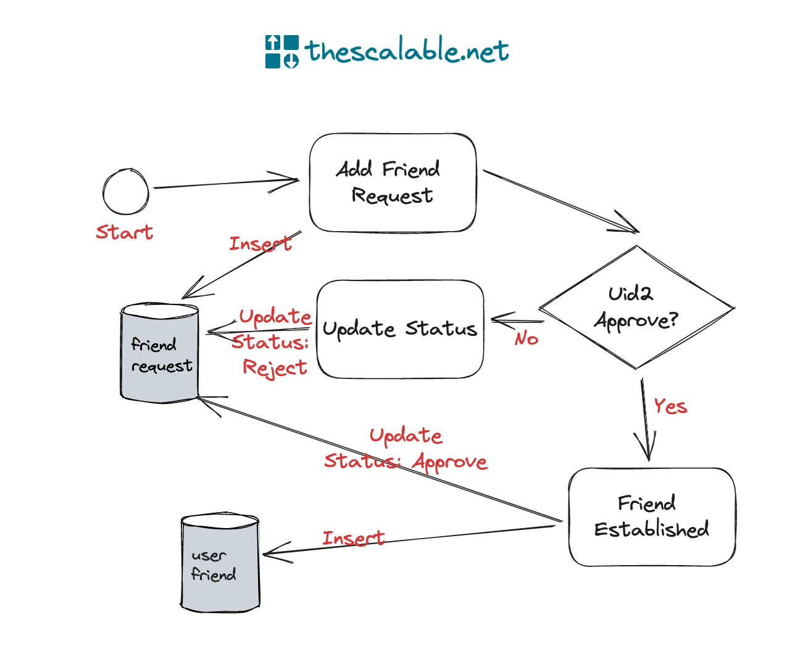

2026/09/22
Checking the official docs of SQLAchemy.
Having multiple questions in my mind:

1. How identify map works.
2. If multiple users register accounts at the same time,
   should Postgres be responsible to generate the UUID instead of generating it in Python.
3. If there are more than one registration using same Email address (which should be Unique), what should I do with
   that.
4. How Fastapi handles thousands of request at the same time, while the connection pool's size is just 20 max. (Maybe it
   works, but I don't know.)

Next steps:

1. Write the schema for user_accounts and user_profiles for both Postgres and SQLAlchemy ORM.
2. Implement login in features and registration. (Plus sending email.)

Things to highlight:
relationship (back_populates="xxx") will take care of data INSERT for both user_accounts and user_profiles. (Also for
joins)
**INSERT usually generates the “values” clause automatically.**

2026/09/23
argon2 is more GPU cracking resistant.
JWT can contain different info like user's email, role, etc. to validate credentials.
Not dependent
Access token (short-lived)
Refresh token (long-lived)

2026/09/26
Tried to read the docs of SQLAchemy, found out lazying loading doesn't work in async engine.
for engine config, pool_recycle and pool_per_ping is set but not too sure does it help with Postgres.
expire_on_commit is really tricky, is recommended to turn it off, in my opinion:
access the expiry attributes makes it requery the database, but detached session is accessible.

2026/09/27
Added the fuction to send the email, using simple SALT (maybe strengthen the security for that later).
Encountered: mailing service could not run, but exception is not raised, need to handle this later

app/utils/security (verify_url_safe_token)
app/utils/email ()
data for testing:
{
"username": "test01",
"email": "yuiyim1230@gmail.com",
"password": "12345678aA!",
"password_repeated": "12345678aA!"
}

Implement JWT first.
Consider using session instead, after learning Redis.

~ 2026/10/06
Added dependencies, run_in_threadpool for hashing password (still need to check later), revoking refresh token (logging
out with valid refresh token, but why?). Changed loading to "raise", excepted for UserAccount with UserProfile.

Cascade for database: on ORM level delete, it will not be allowed, since the column is referred by the child, but if I
load them to the session, it worked.
ondelete = CASCADE ensured that if I delete the parents, children will be deleted.
In async sqlalhcemy, I think as long as lazy loading is not happening, we use the database level cascade.

Exception handing, logging, Redis for blacklisting tokens, tests come next.

~ 2026/10/20
Added Redis, database for failover in authentication. If Redis fails during revoking the session, and the record is
revoked successfully in database, I may need to set up cron jobs or reconciliation to clean up the session living in
Redis.
Also added circuit breaker and logging, but still have tons of uncertain points regarding the Loguru, will come back and
learn it later.

(https://www.coderbased.com/p/user-friends-system-and-database)

uuid4 is generated completely randomly, maybe change user id to uuid4 to increase privacy.

~ 2026/10/30
keep uuid7 for cursor (to sort by time)
Added "Friends" modules. Worked with AI to separate "Users" and "Auth" modules, and implemented service layer.
Exception handling was rewritten for the sake of following the RFC9457 standard.
Next: rewrite the middlewares, logging features and add the rate limiter. Move on to websockets or group features.