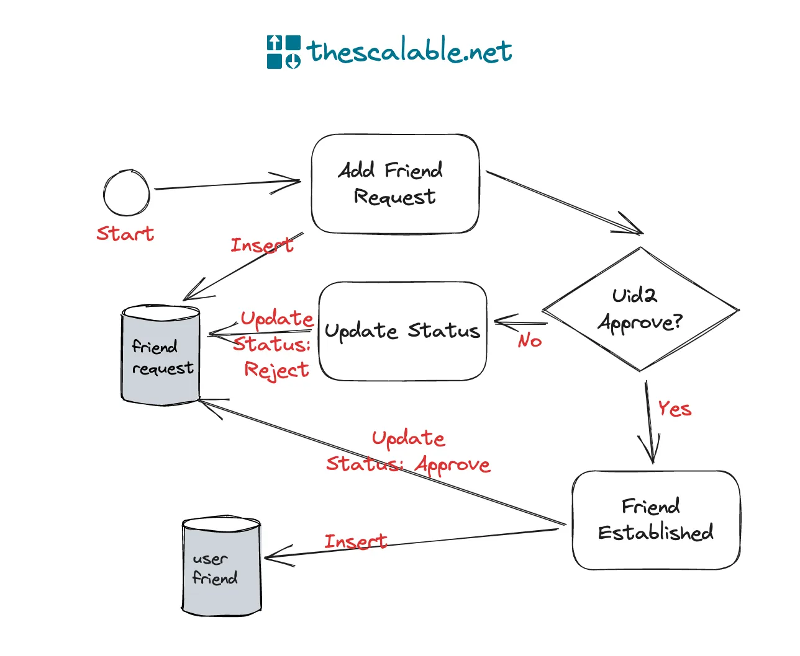

2026/09/22
Checking the official docs of SQLAchemy.
Having multiple questions in my mind:

1. How identify map works.
2. If multiple users register accounts at the same time,
   should Postgres be responsible to generate the UUID instead of generating it in Python.
3. If there are more than one registration using same Email address (which should be Unique), what should I do with
   that.
4. How Fastapi handles thousands of request at the same time, while the connection pool's size is just 20 max. (Maybe it
   works, but I don't know.)

Next steps:

1. Write the schema for user_accounts and user_profiles for both Postgres and SQLAlchemy ORM.
2. Implement login in features and registration. (Plus sending email.)

Things to highlight:
relationship (back_populates="xxx") will take care of data INSERT for both user_accounts and user_profiles. (Also for
joins)
**INSERT usually generates the “values” clause automatically.**

2026/09/23
argon2 is more GPU cracking resistant.
JWT can contain different info like user's email, role, etc. to validate credentials.
Not dependent
Access token (short-lived)
Refresh token (long-lived)

2026/09/26
Tried to read the docs of SQLAchemy, found out lazying loading doesn't work in async engine.
for engine config, pool_recycle and pool_per_ping is set but not too sure does it help with Postgres.
expire_on_commit is really tricky, is recommended to turn it off, in my opinion:
access the expiry attributes makes it requery the database, but detached session is accessible.

2026/09/27
Added the fuction to send the email, using simple SALT (maybe strengthen the security for that later).
Encountered: mailing service could not run, but exception is not raised, need to handle this later

app/utils/security (verify_url_safe_token)
app/utils/email ()
data for testing:
{
"username": "test01",
"email": "yuiyim1230@gmail.com",
"password": "12345678aA!",
"password_repeated": "12345678aA!"
}

Implement JWT first.
Consider using session instead, after learning Redis.

~ 2026/10/06
Added dependencies, run_in_threadpool for hashing password (still need to check later), revoking refresh token (logging
out with valid refresh token, but why?). Changed loading to "raise", excepted for UserAccount with UserProfile.

Cascade for database: on ORM level delete, it will not be allowed, since the column is referred by the child, but if I
load them to the session, it worked.
ondelete = CASCADE ensured that if I delete the parents, children will be deleted.
In async sqlalhcemy, I think as long as lazy loading is not happening, we use the database level cascade.

Exception handing, logging, Redis for blacklisting tokens, tests come next.

~ 2026/10/20
Added Redis, database for failover in authentication. If Redis fails during revoking the session, and the record is
revoked successfully in database, I may need to set up cron jobs or reconciliation to clean up the session living in
Redis.
Also added circuit breaker and logging, but still have tons of uncertain points regarding the Loguru, will come back and
learn it later.

(https://www.coderbased.com/p/user-friends-system-and-database)

uuid4 is generated completely randomly, maybe change user id to uuid4 to increase privacy.

~ 2026/10/30
keep uuid7 for cursor (to sort by time)
Added "Friends" modules. Worked with AI to separate "Users" and "Auth" modules, and implemented service layer.
Exception handling was rewritten for the sake of following the RFC9457 standard.
Next: rewrite the middlewares, logging features and add the rate limiter. Move on to websockets or group features.

2026/11/02
Rate limiter: token bucket in a Lua script (atomic in Redis), used as a FastAPI dependency (IPRateLimiter / UserRateLimiter).
Fails open like the rest of Redis (ADR-009): Redis down -> request allowed, no RateLimit-* headers.

Script registration:
register_script() does NOT talk to Redis, it only hashes the script locally (it needs a client just for the encoder),
so it is created once in lifespan_redis and stored in app.state. EVALSHA runs on each call; if Redis forgot the script
(restart), redis-py catches NoScriptError, loads it and retries. No SCRIPT LOAD at startup, otherwise the app can't boot
without Redis.
TokenBucket only keeps capacity / refill_rate / refill_interval (built once per limiter), script + client are passed per
call.

Login rate limiting (plan, I implement it myself):
What I need to prevent:

- Brute force: many passwords on ONE account -> limit per account.
- Password spraying: one common password on MANY accounts from one IP -> limit per IP.
- CPU DoS: every login/register runs argon2 (slow on purpose) -> limit per IP.
- Username enumeration: probing which accounts exist -> per IP slows it down (doesn't fix the timing leak).
- Account lockout attack: attacker fails on purpose to lock the victim out -> the danger of an account-only limit.
- Credential stuffing (leaked pairs, many IPs, 1 try each): rate limiting barely helps, needs MFA / breached-password
  check / CAPTCHA later.

Design: two layers.

1. IP layer: ratelimit:login:ip:{ip}, counts EVERY attempt (e.g. capacity 20, +1 every 6s). Route dependency, runs
   before the form is read and before hashing.
2. Pair layer: ratelimit:login:fail:{id_hash}:{ip}, counts FAILURES only (e.g. capacity 5, +1 every 60s). Lives in
   AuthService.login because it needs the identifier.

Why a pair (identifier + IP) and not only the account:
attacker at IP X only empties the (alice, X) bucket, real Alice at IP Y can still log in -> no lockout attack.
Trade-off: an attacker with many IPs gets ~5 guesses per IP. Later fix if needed: a loose account-only layer
(e.g. 100 failures/hour).

"Failures only" = consume first, refund on success:

1. allow(pair_key) BEFORE looking up the user / hashing -> EXCEEDED = 429 (a blocked try costs 1 Redis call, not argon2).
2. wrong password / unknown user / not active -> InvalidCredentials, token stays consumed (= 1 failure).
3. success -> DEL pair_key (the user proved they know the password).
   Why not "peek, then count on failure": 50 parallel requests all peek OK before any failure is counted = 50 guesses.
   Consuming first is atomic in Lua, so parallel requests can't exceed the limit. Also no Lua change needed.

Key rules:

- identifier.strip().lower() first: CITEXT makes Alice == alice, without it every capitalization is a new bucket.
- sha256(...)[:16] for the key: no emails in plain text in Redis, short fixed-length keys.
- Count unknown users too, otherwise "never gets 429" tells the attacker the account doesn't exist.
- Same InvalidCredentials for every failure.
- On 429 from the pair layer send its headers; on success send only the IP layer headers (don't tell an attacker how
  many guesses are left for that pair).

Fail open for now: Redis down = both layers off, no brute-force/CPU protection until the breaker closes. Accepted risk,
write it in an ADR (docs/adr/login-rate-limiting.md).
2026/11/03
Finished the rate limiter for auth, users and friends. What I decided and learned:

- Login has two layers. IP layer counts every attempt (30, +1 every 20s). Pair layer counts only FAILED logins per
  (identifier hash, IP) (5, +1 every 180s), so an attacker can't lock out the real user who logs in from another IP.
- The pair limiter is a yield dependency: take a token before the route, yield, delete the key after. No try/except
  needed: when login fails the error comes out at the yield, the delete is skipped, and my exception handler still
  builds the 401.
- The identifier comes from the same OAuth2PasswordRequestForm the route uses. FastAPI builds a dependency once per
  request and shares it, so the form is only parsed once. (This is per request only, nothing is cached between requests.)
- scope="function" on the pair limiter is required, not optional: RedisClient is function-scoped and FastAPI refuses
  to start if a request-scoped dependency depends on it.
- Bad form data: the IP limiter still runs and takes a token, then FastAPI returns 422. The pair limiter and the route
  never run. Junk requests still cost the sender something.
- The "ratelimit:" prefix lives in one place (RateLimiter._redis_key). I had the delete use "rate-limit:" once and the
  bucket never reset.
- Refill one token at a time instead of all at once: stricter for attackers, shorter wait for a real user.
- Logged-in routes use per-user limits, logged-out routes per IP. Many people share one public IP (Wi-Fi, office,
  mobile carrier), so IP limits on cheap routes stay loose.
- One limiter instance per action, not per router. A router-level limiter made refresh and logout eat the login budget.
- Friends: sending requests is the tight one (about 20/hour). Blocking stays loose, a harassed user must always be able
  to block. All list GETs share one read budget.
- Fail open: Redis down = no rate limiting at all. Accepted for now.

Still open:
- Write the ADR for fail-open login limiting (docs/adr/login-rate-limiting.md).
- Run uvicorn with --proxy-headers --forwarded-allow-ips when deploying behind a proxy, or everyone shares one IP bucket.
- Test against real Redis: a failed login creates ratelimit:login:fail:*, a successful one deletes it.
- Message send and websocket connects still need limits once they exist.
