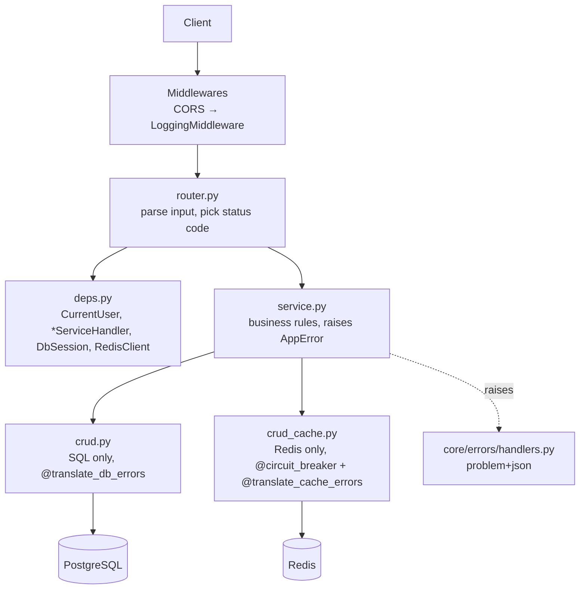

# Design — Application Layout

- **Status:** Living document — describes the code as it is
- **Last updated:** 2026-10-30
- **Related:** `accounts_auth.md`, `relations.md`, `errors.md`, ADR-007 … ADR-011

This is the map of the whole backend: what is built, where each piece lives, how a
request travels through the layers, and the conventions every endpoint follows.

---

## 1. What exists today

| Area | Status | Doc |
|---|---|---|
| Accounts & authentication (`auth`) | **Implemented** | `accounts_auth.md` |
| Own profile (`users`) | **Implemented** (`/users/me` only) | `accounts_auth.md` §8 |
| Friends & blocks (`friends`) | **Implemented** | `relations.md` |
| Error handling (RFC 9457) | **Implemented** | `errors.md` |
| User search / public profile | Planned | — |
| Conversations, messages, files | Planned (model stubs only) | `conversations.md` |
| Group invites | Planned (model stub only) | `relations.md` §6 |
| Notifications | Planned (model stub only) | `notifications.md` |
| Realtime (WebSocket) | Planned | `realtime.md` |
| Rate limiting | Planned (`ErrorCode.RATE_LIMITED` reserved) | `errors.md` §4 |

## 2. Directory hierarchy

```
chat_app/
├─ app/
│  ├─ main.py                  FastAPI app: lifespan, middlewares, router, error handlers
│  ├─ models.py                model registry — imports every module's models (ADR-008)
│  ├─ api/
│  │  ├─ deps.py               shared dependencies: DbSession, RedisClient
│  │  └─ v1/router.py          mounts every module router under /api/v1
│  ├─ core/                    cross-cutting code, no business rules
│  │  ├─ config.py             Settings (pydantic-settings, reads .env)
│  │  ├─ security.py           password hashing, JWT, email-token signing
│  │  ├─ pagination.py         opaque cursor encode/decode
│  │  ├─ responses.py          SuccessResponse[T] envelope
│  │  ├─ logging.py            logging setup (loguru today — see §9)
│  │  ├─ errors/
│  │  │  ├─ schemas.py         ProblemDetail, Violation, ErrorCode, PROBLEM_TYPE_BASE
│  │  │  ├─ exceptions.py      AppError tree (one class per problem type)
│  │  │  ├─ handlers.py        exception → application/problem+json
│  │  │  └─ translators.py     DB / Redis errors → AppError (decorators)
│  │  ├─ infra/
│  │  │  ├─ database.py        async engine, session factory, Base, DB lifespan
│  │  │  ├─ cache.py           Redis connection pool + lifespan
│  │  │  ├─ circuit_breaker.py fail-fast wrapper for Redis calls
│  │  │  └─ lifespan.py        combine_lifespans()
│  │  └─ middlewares/
│  │     ├─ logging.py         request/response log line (active)
│  │     └─ request_id.py      request-id middleware (written, not mounted)
│  └─ modules/                 one folder per feature
│     ├─ auth/                 register, verify email, login, tokens, sessions
│     │  ├─ router.py  deps.py  service.py  crud.py  crud_cache.py
│     │  ├─ schemas.py  models.py (UserRefreshToken)  email.py
│     ├─ users/                own profile
│     │  ├─ router.py  deps.py  service.py  crud.py  schemas.py
│     │  └─ models.py          UserAccount, UserProfile, AccountStatus
│     ├─ friends/              friend requests, friendships, blocks
│     │  ├─ router.py  deps.py  service.py  crud.py  crud_cache.py
│     │  └─ schemas.py  models.py (FriendRequest, FriendLists, UserBlockLists)
│     ├─ invites/              stub (models commented out)
│     ├─ messages/             stub
│     └─ notifications/        stub
├─ alembic/                    migrations (env.py imports app.models)
├─ templates/                  email templates (verify_email.html)
├─ docker/                     example compose files for Postgres and Redis
└─ docs/
   ├─ prd.md                   product requirements
   ├─ design/                  behaviour per area (this folder)
   ├─ adr/                     architecture decision records
   └─ HANDOFF.md               prompt for continuing in a new session
```

## 3. Layers and their rules



| Layer | May do | Must not do |
|---|---|---|
| `router.py` | read path/query/body/cookie, call **one** service method, wrap the result in `SuccessResponse`, set cookies | contain business rules or SQL |
| `deps.py` | build the service (`FriendServiceHandler`, …), resolve `CurrentUser` | hold state |
| `service.py` | business rules, ordering of calls, `commit()` when a Redis write must follow a committed row, raise `AppError` subclasses | build SQL statements |
| `crud.py` | one SQL statement (or one small unit) per function; return rows / `None` / `bool` | raise business errors (it returns `None`/`False`; the service decides) |
| `crud_cache.py` | one Redis operation per function | be required for correctness (Redis may be down — ADR-009) |

Every crud function carries `@translate_db_errors`; every cache function carries
`@redis_circuit_breaker.decorator(...)` **outside** `@translate_cache_errors`.

## 4. Request lifecycle

1. **ServerErrorMiddleware** (Starlette, outermost) → **CORSMiddleware** → **LoggingMiddleware**.
2. FastAPI resolves dependencies. `DbSession` and `RedisClient` use `scope="function"`:
   they are closed **before** the response is sent.
3. The router calls the service; the service calls crud / crud_cache.
4. On success, `get_db` **commits** after the route returns and before the response is
   sent. A commit failure is translated (ADR-010) and becomes an error response — the client
   never receives a 2xx for data that was not saved.
5. On any exception, `get_db` rolls back, and the matching exception handler returns
   `application/problem+json` (see `errors.md`).

## 5. Conventions (all endpoints)

| Topic | Rule |
|---|---|
| Base path | `/api/v1` |
| JSON field names | **camelCase** in and out (`passwordRepeated`, `displayName`, `nextCursor`) |
| Success body | `{"message": string \| null, "data": T \| null}` (`SuccessResponse[T]`) |
| `204` responses | no body |
| Error body | RFC 9457 `application/problem+json` — `errors.md` |
| Authentication | `Authorization: Bearer <accessToken>`; the refresh token travels only in the `refreshToken` httpOnly cookie |
| IDs | UUIDv7 strings (time-ordered) |
| Timestamps | UTC, ISO-8601 (`2026-10-30T12:00:00Z`) |
| Pagination | keyset: `?limit=` (1–100, default 50) and `?cursor=` (opaque string from the previous page's `nextCursor`; `null` = last page). Never offsets (ADR-004) |
| Validation errors | **400** with `code: VALIDATION_ERROR` and a `violations` list |

## 6. API surface

### Implemented

| Method | Path | Auth | Doc |
|---|---|---|---|
| POST | `/auth/register` | — | `accounts_auth.md` §7.1 |
| GET | `/auth/verify-email?token=` | — | §7.2 |
| POST | `/auth/login` | — | §7.3 |
| POST | `/auth/refresh` | refresh cookie | §7.4 |
| POST | `/auth/logout` | refresh cookie | §7.5 |
| POST | `/auth/logout-all` | refresh cookie | §7.6 |
| GET | `/users/me` | access | §8.1 |
| PATCH | `/users/me` | access | §8.2 |
| POST | `/friends/requests` | access | `relations.md` §7.1 |
| GET | `/friends/requests` | access | §7.2 |
| GET | `/friends/requests/sent` | access | §7.2 |
| POST | `/friends/requests/{request_id}/accept` | access | §7.3 |
| POST | `/friends/requests/{request_id}/decline` | access | §7.4 |
| DELETE | `/friends/requests/{request_id}` | access | §7.5 |
| GET | `/friends` | access | §7.6 |
| DELETE | `/friends/{user_id}` | access | §7.7 |
| POST | `/blocks/{user_id}` | access | §7.8 |
| DELETE | `/blocks/{user_id}` | access | §7.9 |
| GET | `/blocks` | access | §7.10 |

### Planned (not built)

`GET /users/search`, `GET /users/{user_id}` — **must be declared after `/users/me`**, or
`"me"` is parsed as a UUID. Conversations, messages, files, invites, notifications, and
`WS /ws`: see `conversations.md`, `notifications.md`, `realtime.md`.

## 7. Infrastructure

| Piece | Setting (from code) |
|---|---|
| PostgreSQL | `asyncpg`; pool 10 + overflow 10; `pool_pre_ping`; `pool_recycle=3600`; `hide_parameters=True` (SQL values never appear in error text) |
| Redis | pool of 50; 1 s socket and connect timeouts; 2 retries with jittered backoff on connection/timeout errors |
| Lifespan | `combine_lifespans(lifespan_database, lifespan_redis)` — creates the Redis pool, disposes both on shutdown |
| Migrations | Alembic; `alembic/env.py` imports `app.models` so every table is known |
| Config | `.env` read by `Settings`. **`request_cool_down` (days) is required but missing from `.env.example`** — add it when setting up |

## 8. How the code evolved

| | First commit `1e3b2aa` | `1a77720` | Working tree (uncommitted) |
|---|---|---|---|
| Layout | flat `core/` (cache, database, exceptions, exception_handlers, …); all account code in `modules/users/` | + `core/circuit_breaker.py`, `core/logging.py`, `core/middlewares/` | `core/` split into `errors/`, `infra/`, `middlewares/`; new `auth/` and `friends/` modules; `app/models.py` registry |
| Layers | routers call crud / crud_cache functions directly; `users/service.py` holds helper functions (`issue_session`, `set_refresh_cookie`); `get_current_user` logic in `api/deps.py` | same | router → **service class** → crud / crud_cache in every module (ADR-008) |
| Auth | JWT + DB session rows + Redis session cache (`auth:session:{sid}`) | + circuit breaker around Redis calls | same behaviour, moved to `modules/auth/` (`AuthService`) |
| Profile path | `/auth/me` | `/auth/me` | **`/users/me`** |
| Social graph | — | — | friend requests, friendships, blocks, Redis cooldown (`relations.md`) |
| Errors | `{"message": …}`; 6 handler functions registered for 10 exception classes | + logging in handlers | **RFC 9457** problem details, `ErrorCode`, 4 handlers, sqlstate translation (ADR-007, ADR-010) |
| Typing | partial | partial | every function annotated; `pyright` strict mode clean except one intentional unused import (`send_verification_mail`) |

## 9. Known gaps

- Validation errors are **400**, but FastAPI's generated `/docs` still shows a **422** schema on every route.
- A 500 from the catch-all handler is sent by `ServerErrorMiddleware`, outside CORS — a browser sees a CORS error instead of the problem body.
- Logging still uses loguru; the format prints a literal `{extra}`, so structured fields are lost. Planned: move to the standard `logging` module (`HANDOFF.md`).
- No rate limiting (PRD C-3).
- Verification email sending is disabled; `dev_mode=true` auto-activates new accounts.
- Login timing leak (unknown user answers faster than a wrong password) — to fix before release.
