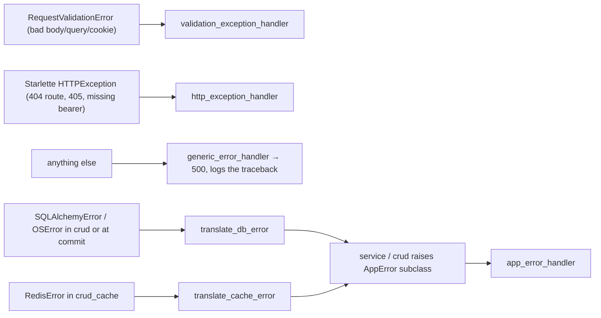

# Design — Error Handling

- **Status:** Implemented — describes the code as it is
- **Last updated:** 2026-10-30
- **Code:** `app/core/errors/` (`schemas.py`, `exceptions.py`, `handlers.py`, `translators.py`), `app/api/deps.py`
- **Related:** ADR-007 (problem details), ADR-010 (database error translation)

---

## 1. One error shape for the whole API

Every error — from our code, from FastAPI validation, from Starlette routing, or an
unexpected crash — is returned as **RFC 9457 Problem Details** with
`Content-Type: application/problem+json`:

```json
{
  "type": "https://api.chat-app.example/problems/request-cooldown",
  "status": 429,
  "title": "Too Many Requests",
  "detail": "Retry After 30s.",
  "instance": "/api/v1/friends/requests",
  "code": "REQUEST_COOLDOWN"
}
```

| Member | Meaning | Rule |
|---|---|---|
| `type` | URI that identifies the **kind** of problem | `PROBLEM_TYPE_BASE + "/" + slug`; slug = `code` lower-cased with `_` → `-`. Stable forever once published. `about:blank` for unmapped HTTP errors |
| `status` | HTTP status, repeated in the body | — |
| `title` | short human summary | `HTTPStatus(status).phrase` |
| `detail` | human explanation of **this** occurrence | never contains SQL, table names or stack traces |
| `instance` | the request path | — |
| `code` | **stable machine code** (`ErrorCode` enum) | clients branch on `code`, never on `detail` |
| `violations` | only on validation errors: `[{"field", "message"}]` | `field` like `email`, `query.limit`, `cookie.refreshToken` |
| `traceId` | reserved (read from `request.state.trace_id`; nothing sets it yet) | omitted when empty |

`PROBLEM_TYPE_BASE` is `https://api.chat-app.example/problems`. `.example` is a reserved
domain (RFC 2606): replace it with the real domain **before** the first public release.

### Headers

| Header | Sent when |
|---|---|
| `WWW-Authenticate: Bearer` | every `401` (RFC 9110 requires it) |
| `Retry-After: <seconds>` | the exception has `retry_after` set (`REQUEST_COOLDOWN`, retryable DB errors) |
| `Allow: <methods>` | `405` (from Starlette) |

## 2. How it is wired



`register_exception_handlers(app)` in `handlers.py` registers the four handlers; `main.py`
calls it once.

**Exception tree** (`exceptions.py`):

```
AppError (500)
├─ DatabaseError (503, optional retry_after)
├─ CacheError (503) ─ CacheConnectionError, CacheServerError
├─ InvalidCursor (400)
└─ DomainError (business rules)
   ├─ ConflictError (409) · ConstraintViolation (400) · EmptyUpdate (400)
   ├─ AuthError (401) ─ InvalidToken, ExpiredToken, Unauthenticated, InvalidCredentials,
   │                    EmailNotVerified (403), UserNotFound (404), UserExists (409), AlreadyVerified (409)
   ├─ FriendRequestError (400) ─ SelfRequestError, FriendRequestNotAllowedError (403),
   │                    RequestNotFound (404), NotFriendsError (404), UserRequestedNotFound (404),
   │                    FriendsAlreadyError (409), RequestedAlreadyError (409), CoolDownError (429)
   └─ RelationError (500) ─ BlockedAlready (409), BlockRecordNotFound (404)
```

Each leaf class fixes its own `code`, `status`, `type` and default `detail`, so adding an
error is one new class — no handler change.

## 3. Error catalog

| Status | `code` | Raised by | Meaning |
|---|---|---|---|
| 400 | `VALIDATION_ERROR` | FastAPI validation | body / query / cookie invalid; see `violations` |
| 400 | `SELF_REQUEST` | `SelfRequestError` | action targets yourself (request, unfriend, block, unblock) |
| 400 | `INVALID_CURSOR` | `InvalidCursor` | `cursor` was not produced by the server |
| 400 | `EMPTY_UPDATE` | `EmptyUpdate` | `PATCH /users/me` with no fields |
| 400 | `CONSTRAINT_VIOLATION` | `ConstraintViolation` | DB check constraint failed (sqlstate `23514`) |
| 400 | `BAD_REQUEST` | Starlette `HTTPException(400)` | generic bad request |
| 401 | `UNAUTHENTICATED` | `Unauthenticated`, missing bearer header | not logged in / account not active |
| 401 | `INVALID_TOKEN` | `InvalidToken` | bad signature, wrong token type, revoked session |
| 401 | `TOKEN_EXPIRED` | `ExpiredToken` | token expired — refresh |
| 401 | `INVALID_CREDENTIALS` | `InvalidCredentials` | login failed (one code for every reason) |
| 401 | `AUTHENTICATION_ERROR` | `AuthError` (base) | not raised directly today |
| 403 | `REQUEST_NOT_ALLOWED` | `FriendRequestNotAllowedError` | a block exists between the users |
| 403 | `EMAIL_NOT_VERIFIED` | `EmailNotVerified` | reserved; not raised today |
| 404 | `USER_NOT_FOUND` | `UserNotFound`, `UserRequestedNotFound` | target user / profile does not exist |
| 404 | `REQUEST_NOT_FOUND` | `RequestNotFound` | no such pending request for you |
| 404 | `NOT_FRIENDS` | `NotFriendsError` | unfriend when not friends |
| 404 | `NOT_BLOCKED` | `BlockRecordNotFound` | unblock when not blocked |
| 404 | `ROUTE_NOT_FOUND` | Starlette | unknown URL |
| 405 | `METHOD_NOT_ALLOWED` | Starlette | wrong method; see `Allow` |
| 409 | `USER_EXISTS` | `UserExists` (also unique constraint on username/email) | registration conflict |
| 409 | `ALREADY_VERIFIED` | `AlreadyVerified` | verification link used on an active account |
| 409 | `ALREADY_FRIENDS` | `FriendsAlreadyError` | request to a friend |
| 409 | `REQUEST_ALREADY_EXISTS` | `RequestedAlreadyError` | pending request already exists |
| 409 | `ALREADY_BLOCKED` | `BlockedAlready` | block twice |
| 409 | `CONFLICT` | `ConflictError` | other unique / foreign-key violation (sqlstate `23505`, `23503`) |
| 429 | `REQUEST_COOLDOWN` | `CoolDownError` | declined recently; `Retry-After` |
| 429 | `RATE_LIMITED` | — | reserved for the rate limiter |
| 500 | `INTERNAL_ERROR` | `AppError`, `RelationError`, unhandled exceptions | bug; traceback is logged, never sent |
| 503 | `DATABASE_UNAVAILABLE` | `DatabaseError` | Postgres unreachable, busy, or timed out |
| 503 | `CACHE_UNAVAILABLE` | `CacheError` family | Redis failure — in practice absorbed by the circuit breaker (ADR-009) |
| any | `HTTP_ERROR` | Starlette `HTTPException` with another status | `type` is `about:blank` |

## 4. Rate limiting (planned)

`ErrorCode.RATE_LIMITED` is reserved and `app_error_handler` already turns
`exc.retry_after` into a `Retry-After` header. A limiter only needs to raise an `AppError`
subclass with status 429, that code, and `retry_after` set.

## 5. Database error translation (ADR-010)

Applied by `@translate_db_errors` on every crud function **and** around the commit in
`get_db`. Checked in this order:

| # | Condition | Result |
|---|---|---|
| 1 | `OSError` (connection refused / timed out — never wrapped by SQLAlchemy) | 503 `DATABASE_UNAVAILABLE` |
| 2 | `IntegrityError` on a known constraint (`user_account_username_key`, `user_account_email_key`) | 409 `USER_EXISTS` |
| 3 | `IntegrityError` sqlstate `23505` unique / `23503` foreign key | 409 `CONFLICT` |
| 4 | `IntegrityError` sqlstate `23514` check | 400 `CONSTRAINT_VIOLATION` |
| 5 | any error, sqlstate `40001` serialization / `40P01` deadlock | 503 + `Retry-After: 1` |
| 6 | any error, sqlstate `55P03`, `57014` (timeouts), `57P01`–`57P03` (shutdown/startup), `53300` (too many connections), class `08` (connection) | 503 |
| 7 | `OperationalError`, pool `TimeoutError` | 503 |
| 8 | everything else (e.g. `23502` not-null, class `22` data errors, `42P01` missing table) | 500 — these mean a bug in our code |

`get_db` translates **only** the commit, so an `OSError` raised by route code (e.g. SMTP)
stays a 500 instead of being reported as "database down".

## 6. Redis error translation

`@translate_cache_errors`: connection/timeout → `CacheConnectionError`; response/data error
→ `CacheServerError`; other → `CacheError`. The circuit breaker outside it catches every
`CacheError` and returns the function's fallback, so callers degrade instead of failing.

## 7. Known gaps

- FastAPI's generated `/docs` still shows `422 HTTPValidationError` on every route; the real
  answer is `400` problem+json. Fix by declaring `responses=` on the routers.
- A 500 is produced outside `CORSMiddleware`, so it carries no CORS headers.
- `traceId` is never set (request-id middleware not mounted) — part of the logging work.
